[中文](README.md) · [English](README.en.md)

# ChatGPT / Codex 宠物

  

作者 B 站：[百香里_](https://space.bilibili.com/147521399)

用这套 Skill 制作自己的 ChatGPT / Codex 宠物，也可以下载现成宠物素材，按说明导入。
先看下面的效果，再选你需要的下载。

> 本项目仅供娱乐和学习交流使用。角色形象的版权归原权利人所有，如涉嫌侵权请联系删除，详见底部[免责声明](#免责声明)。

## 支持的输入

- **真实宠物的照片**：你自己的猫、狗、仓鼠等，拍几张清楚的照片即可。
- **概念参考图**：手绘设定图、表情包、头像、插画等。
- **任何物体都可以**：不限于动物或已有角色，只要有参考图，就能做成宠物。

参考图越清楚，效果越好。

## 下载

| 我想要 | 下载 |
|---|---|
| 只要 Skill（自己做宠物） | [下载 ZIP](https://github.com/yuejianli-z/chatgpt-codex-pet-skill/raw/refs/heads/main/downloads/pet-skill-3.3.7.zip) |
| 只要现成宠物（11 个可导入素材包） | [查看逐个下载链接](downloads/README.md) |
| 两个都要 | [下载整仓 ZIP](https://github.com/yuejianli-z/chatgpt-codex-pet-skill/archive/refs/heads/main.zip)（含 Skill、当前素材与预览图） |

## 角色预览

下面每张动图展示对应角色导入后的九组动作与十六向注视效果（展示用 GIF，不是导入文件）。安装用的透明图集见下方下载区。

### 01 · 短短（作者的猫） / Duanduan (the author's cat)

  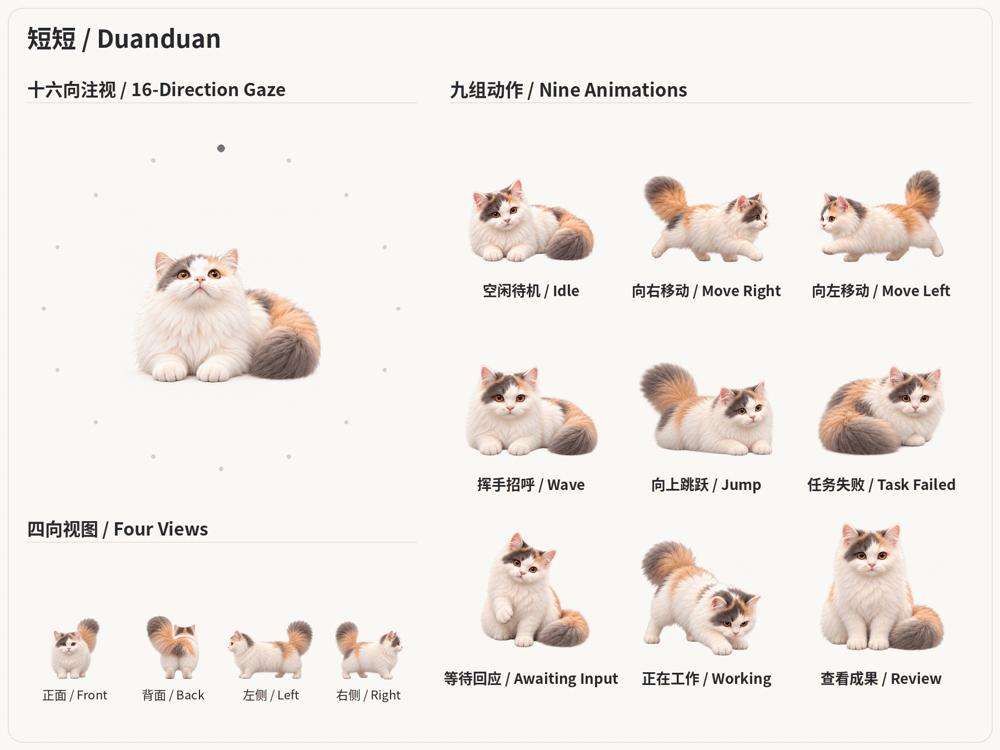

### 02 · 斯莫德（英雄联盟英雄，蕊雪盈春：聚珍皮肤） / Smolder (League of Legends, Petals of Spring skin)

  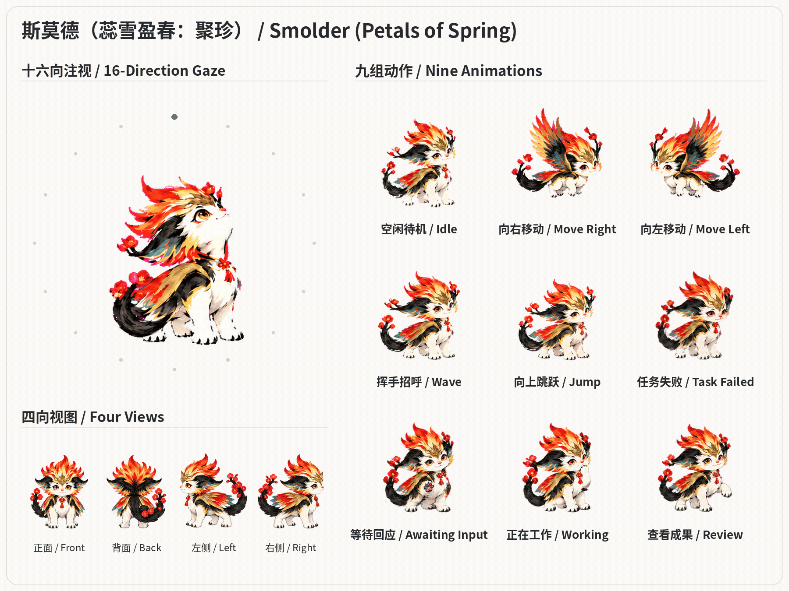

### 03 · 奶蛙 / Naiwa

  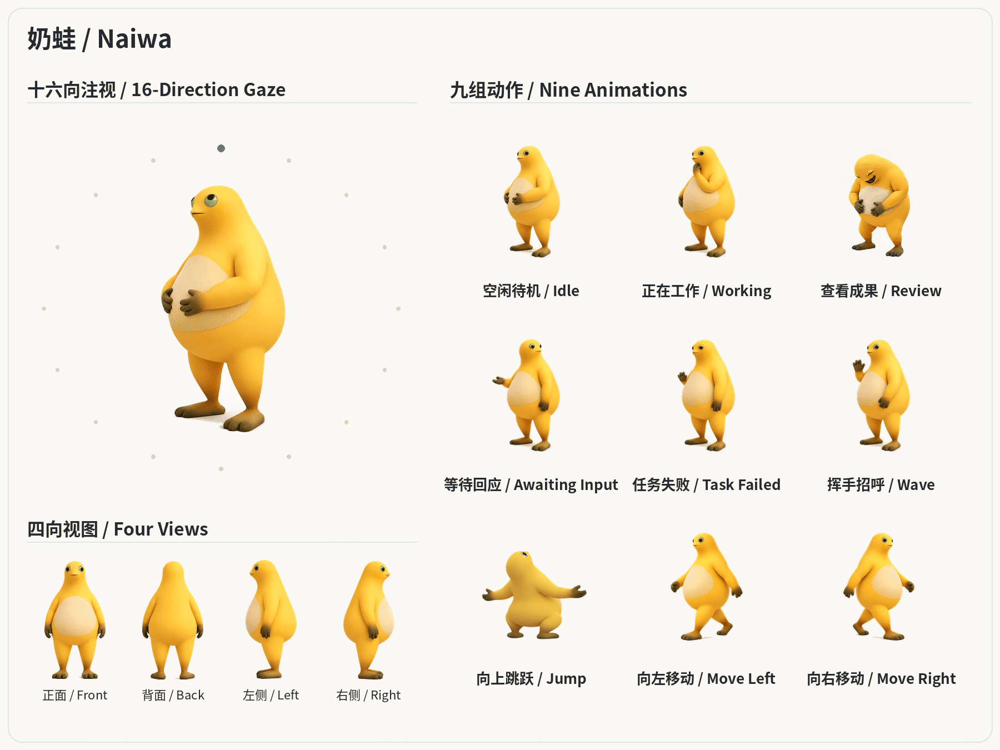

### 04 · DeepSeek鲸鱼娘 / DeepSeek Whale Girl

  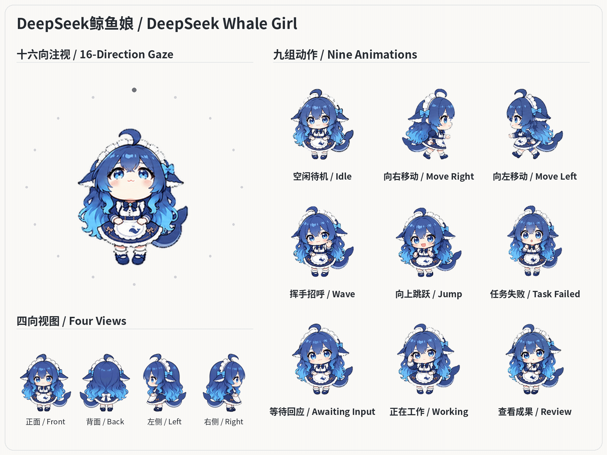

### 05 · 小熊猫 / Red Panda

  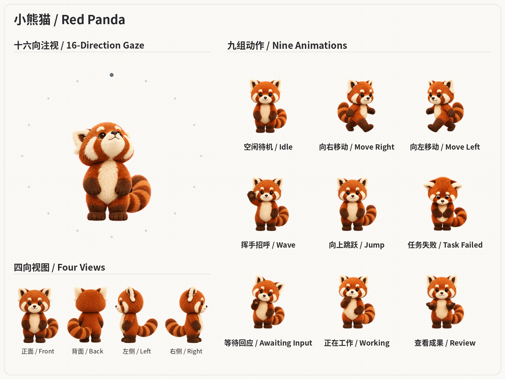

### 06 · 比格犬 / Beagle

  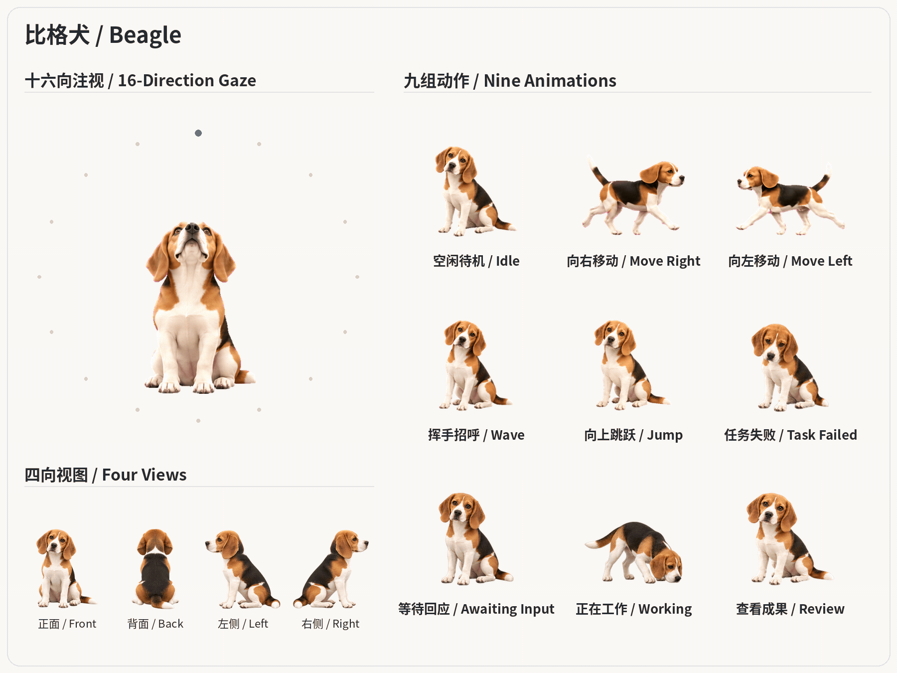

### 07 · 卡皮巴拉 / Capybara

  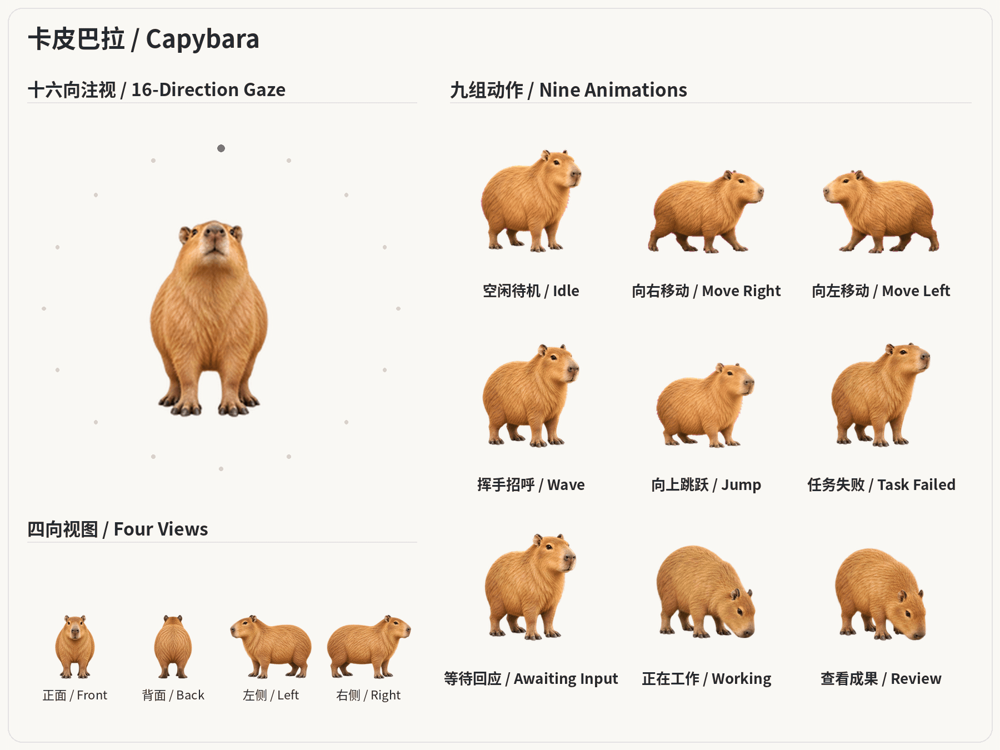

### 08 · 银月（《凡人修仙传》角色） / Yinyue (character from Mortal Cultivation Chronicles)

  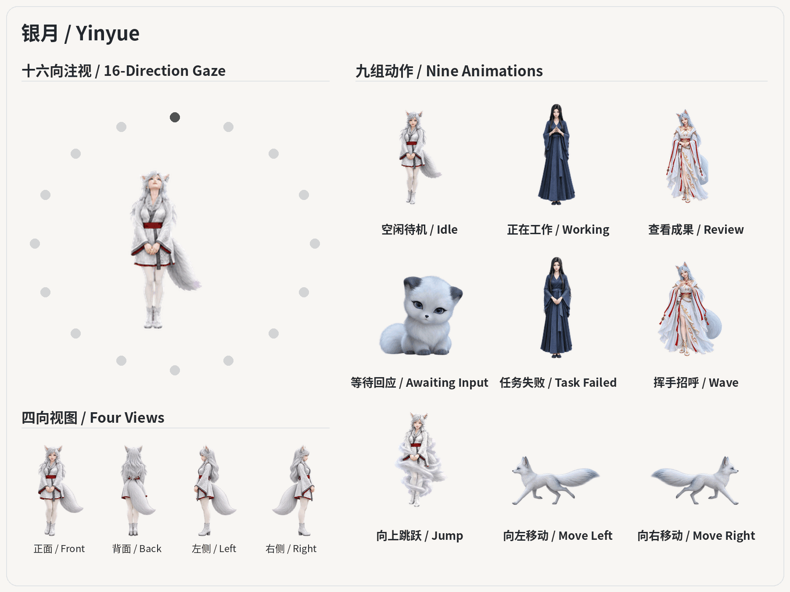

### 09 · 木棍人 / Tung Tung

  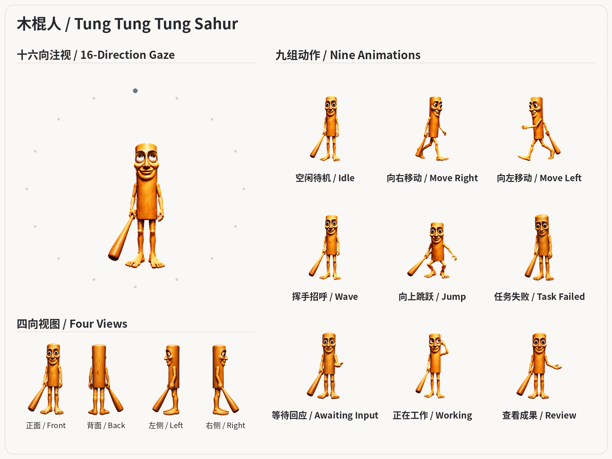

### 10 · 笨笨的韭菜 / Benjiu

  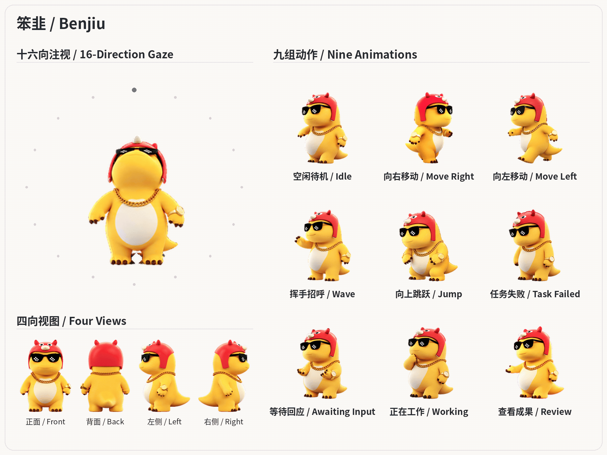

### 11 · 做多中国的好人豆子 / Douzi

  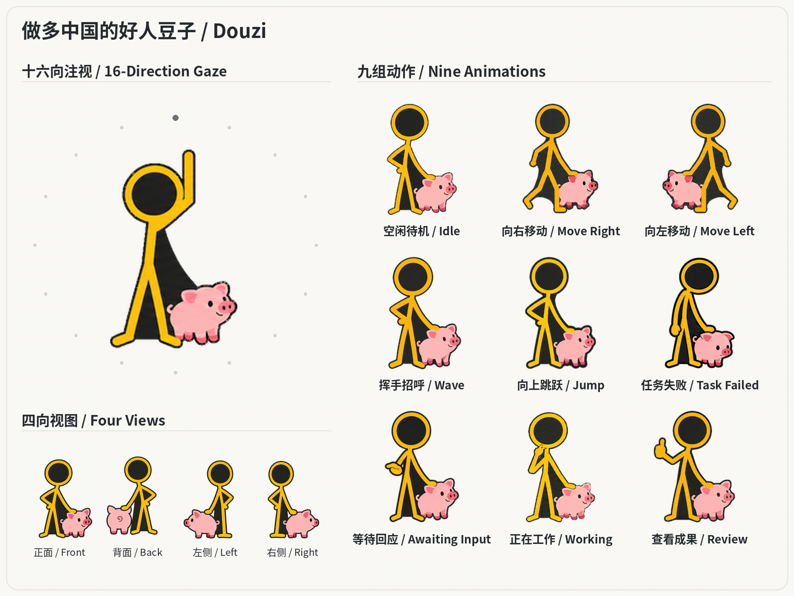

<strong>宠物动作：9 种动作在什么情况下触发</strong>

| 动作 | 触发方式 / 用途 | 帧数 |
|---|---|---:|
| 待机 idle | 默认静置；其他动作结束后回到待机 | 6 |
| 工作中 running | 处理任务，不是角色在屏幕上跑动 | 6 |
| 待查看 review | 任务完成，结果待查看 | 6 |
| 等待 waiting | 需要用户输入或批准 | 6 |
| 失败 failed | 任务出错或失败 | 8 |
| 招呼 waving | 桌面宠物首次显现 | 4 |
| 跳跃 jumping | 鼠标移入桌面宠物 | 5 |
| 向左移动 running-left | 按住桌面宠物向左拖动 | 8 |
| 向右移动 running-right | 按住桌面宠物向右拖动 | 8 |
| 16 向注视 | 鼠标围绕页面顶部宠物移动，切换对应方向 | 每方向 1 张，共 16 张 |

触发方式以已测试客户端为准，不保证所有版本一致。任务状态不等于画面一直播放该动作：任务仍在处理时，动画也可能已回到待机。上表是设计与展示顺序，导入图集的行序固定，不能跟着重排。

<strong>制作规格：导入图集、安装包与 Skill 的具体格式</strong>

| 需要产出什么 | 规格 / 用途 |
|---|---|
| 导入图集 | 一张透明 PNG 或 WebP，精确 1536 × 2288 像素；8 列 × 11 行，每格 192 × 208；57 张动作帧＋16 张注视图，余下 15 格透明；不超过 20 MiB |
| 效果预览 | 展示九种动作、四个参考视图与 16 向注视的 GIF，不是导入文件 |
| 宠物安装包 | 图集、角色信息、导入说明及校验报告 |
| Skill | 独立制作流程、参考规范、模板和检查脚本 |

## 免责声明

- 本项目仅供娱乐和学习交流使用，请勿用于任何商业用途。使用者需自行承担使用风险。
- 仓库中的角色形象（包括但不限于《英雄联盟》斯莫德、《凡人修仙传》银月、DeepSeek 相关形象、创作者头像和网络流行形象）的名称、设定与版权归各自权利人所有。本项目中的宠物图集是基于这些形象的粉丝向再创作，与原权利人及相关公司没有隶属、授权或合作关系，也不代表其立场。
- MIT 许可证只适用于本仓库中由贡献者拥有权利的代码、文档和模板，不适用于上述角色形象、参考图和宠物素材。
- 如果您是相关内容的权利人，认为本项目侵犯了您的权利，请通过本仓库的 Issues 联系，经核实后会及时删除或更换。详见[许可与素材来源](docs/ASSET-POLICY.zh-CN.md)。

[安装方式](downloads/README.md) · [Skill 正文](skills/create-desktop-companion/SKILL.md) · [兼容性](skills/create-desktop-companion/docs/zh-CN/compatibility.md) · [许可与素材来源](docs/ASSET-POLICY.zh-CN.md)
